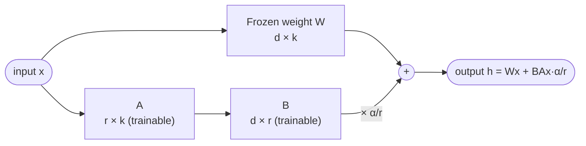

# LLM fine-tuning with LoRA & QLoRA

[](https://github.com/ThomasBaileyUK/llm-lora-finetuning/actions/workflows/ci.yml)
[](https://colab.research.google.com/github/ThomasBaileyUK/llm-lora-finetuning/blob/main/notebooks/colab_quickstart.ipynb)


A small, readable toolkit for fine-tuning open LLMs with **LoRA** and **QLoRA** on a single GPU, including a free Colab T4. It's built on Hugging Face [TRL](https://github.com/huggingface/trl), [PEFT](https://github.com/huggingface/peft) and [Transformers](https://github.com/huggingface/transformers).

It ships with a worked example: turning **Qwen3-0.6B** into a concise *recruiter assistant* for applied-AI hiring. It learns to explain RAG to a hiring manager, write Boolean strings and draft outreach that doesn't sound like spam.

```bash
python -m lora_ft.train -c configs/qwen3_0.6b_lora.yaml                     # train (~10 min on a T4)
python -m lora_ft.chat --adapter outputs/qwen3-0.6b-lora/adapter --compare  # base vs fine-tuned
```

## What's inside

- **One YAML config per run.** Swap the model, dataset or LoRA rank without touching code, and override anything from the CLI with `--set train.max_steps=20`.
- **LoRA, QLoRA (4-bit NF4) and 8-bit**, plus DoRA and rsLoRA switches.
- **Hardware-aware precision.** It picks bf16 on Ampere+ GPUs, fp16 on T4/V100 and fp32 on CPU or Apple Silicon.
- **Bring your own data.** It auto-converts the `messages`, ShareGPT, Alpaca, prompt/completion and Q&A formats, and validation errors name the row that's wrong.
- **Assistant-only loss.** The model learns from its replies, not from your prompts.
- **Evaluation report.** Shows perplexity on held-out answers plus side-by-side base vs fine-tuned generations, in Markdown.
- **Merge and share.** Bake the adapter into a standalone model, or push either one to the Hugging Face Hub.
- **Tests and CI.** These cover config and data handling, and run without a GPU.

## How LoRA works

Full fine-tuning updates every weight in the model, which takes billions of parameters and a lot of GPU memory. LoRA ([Hu et al., 2021](https://arxiv.org/abs/2106.09685)) **freezes** the original weights and learns a small low-rank update alongside them:



For a 4096 × 4096 projection with rank `r = 16`, LoRA trains 16 × (4096 + 4096) ≈ **131k** parameters instead of **16.8M**, which is 0.78%. The adapter you save is a few megabytes, and you can switch it on and off on top of the same base model.

**QLoRA** ([Dettmers et al., 2023](https://arxiv.org/abs/2305.14314)) goes further by storing the frozen base model in 4-bit NF4. That's how a 4B–8B model fits on a single consumer or Colab GPU.

## Quickstart

### Option A: Google Colab (no setup)

Click **Open in Colab** above, choose a **T4 GPU** runtime and run the cells top to bottom.

### Option B: your own machine

```bash
git clone https://github.com/ThomasBaileyUK/llm-lora-finetuning.git
cd llm-lora-finetuning
python -m venv .venv && source .venv/bin/activate
pip install -e ".[qlora,dev]"        # drop "qlora" on macOS/Windows (bitsandbytes is Linux + NVIDIA)

make test                             # unit tests, no GPU needed
make smoke                            # 10-step run on a 135M model, which works on CPU
make train                            # the real run: LoRA on Qwen3-0.6B
```

## Configs

| Config | Model | Method | Approx. GPU memory | Good for |
|---|---|---|---|---|
| `smoke_test.yaml` | SmolLM2-135M-Instruct | LoRA | CPU is fine | Checking the pipeline end to end |
| `qwen3_0.6b_lora.yaml` | Qwen3-0.6B | LoRA (16-bit) | ~5 GB | Free Colab T4, fast iteration |
| `qwen3_4b_qlora.yaml` | Qwen3-4B | QLoRA (4-bit) | ~8 GB | Free Colab T4, much stronger model |
| `qwen3_8b_qlora_hf_dataset.yaml` | Qwen3-8B | QLoRA (4-bit) | ~16–20 GB | A10G / L4 / RTX 4090 / A100, public dataset |

Memory depends on `max_length` and batch size. If you run out, halve `per_device_train_batch_size` and double `gradient_accumulation_steps`.

The settings you'll touch most:

```yaml
lora:
  r: 16                    # adapter rank: 8–64. Higher = more capacity, more memory
  alpha: 32                # scaling; ~2× r is a good default
  target_modules: all-linear
train:
  learning_rate: 2.0e-4    # LoRA wants ~10× the full fine-tuning rate
  num_train_epochs: 3
  max_length: 1024
  assistant_only_loss: true
```

## Bring your own data

Put one example per line in a `.jsonl` file. The preferred format is chat `messages`:

```json
{"messages": [{"role": "user", "content": "What's an FDE?"}, {"role": "assistant", "content": "A forward deployed engineer is..."}]}
```

These formats are also converted automatically:

| Format | Example keys |
|---|---|
| ShareGPT | `{"conversations": [{"from": "human", "value": ...}, {"from": "gpt", "value": ...}]}` |
| Alpaca | `{"instruction": ..., "input": ..., "output": ...}` |
| Prompt / completion | `{"prompt": ..., "completion": ...}` or `{"prompt": ..., "response": ...}` |
| Q&A | `{"question": ..., "answer": ...}` |

`.json` lists and `.csv` files work too, as does any Hugging Face dataset id (e.g. `data.train: trl-lib/Capybara`). Then run:

```bash
python -m lora_ft.train -c configs/qwen3_0.6b_lora.yaml \
  --set data.train=data/my_data.jsonl data.eval=null data.eval_fraction=0.1 train.output_dir=outputs/my-run
```

**How much data?** 50–100 good examples are enough to teach a format or tone. Teaching a new skill usually takes 1,000+. Quality matters far more than quantity, and duplicated or contradictory answers hurt.

To change the sample dataset, edit `scripts/build_sample_data.py` and run `make data`.

## After training

Each run writes to `outputs/<run>/`:

```
adapter/            LoRA weights (a few MB) + tokenizer — this is your fine-tuned model
run_config.yaml     the exact config used, for reproducibility
summary.json        trainable params, timings, final metrics, full log history
loss.png            training and eval loss curves
```

```bash
# chat (shows the base model's answer too with --compare)
python -m lora_ft.chat --adapter outputs/qwen3-0.6b-lora/adapter --compare

# evaluation report: perplexity + side-by-side answers -> outputs/qwen3-0.6b-lora/eval_report.md
python -m lora_ft.evaluate --adapter outputs/qwen3-0.6b-lora/adapter --data data/recruiter_assistant/eval.jsonl

# merge into a standalone model (for vLLM, TGI, `transformers serve`, or GGUF conversion)
python -m lora_ft.merge --adapter outputs/qwen3-0.6b-lora/adapter --out outputs/qwen3-0.6b-merged

# publish the adapter on the Hugging Face Hub during training
python -m lora_ft.train -c configs/qwen3_0.6b_lora.yaml --set train.push_to_hub=true train.hub_model_id=your-name/qwen3-recruiter-lora
```

## Results

<!-- Fill this in from outputs/<run>/summary.json and eval_report.md after your first run. -->

| Run | Hardware | Time | Trainable params | Eval loss | Perplexity (base → tuned) |
|---|---|---|---|---|---|
| Qwen3-0.6B LoRA, sample data | Colab T4 | — | — | — | — → — |

## Project structure

```
configs/                  YAML run configs
data/recruiter_assistant/ sample train/eval conversations
notebooks/                Colab quickstart
scripts/                  dataset builder
src/lora_ft/
  config.py               typed config + CLI overrides
  data.py                 format detection, validation, loading
  train.py                LoRA / QLoRA training with TRL's SFTTrainer
  chat.py                 interactive chat, base-vs-tuned comparison
  evaluate.py             perplexity + side-by-side report
  merge.py                merge adapter into the base model
  utils.py                precision / hardware / tokenizer helpers
tests/                    unit tests (run on CI without a GPU)
```

## Troubleshooting

- **`CUDA out of memory`:** lower `train.per_device_train_batch_size` or `train.max_length`, switch to a `qlora` config, or keep `gradient_checkpointing: true`.
- **`bf16` errors on Colab:** shouldn't happen, because T4s are detected and use fp16. If you set `model.dtype: bfloat16` by hand, set it back to `auto`.
- **Assistant-only loss error:** the model's chat template needs `` markers. TRL patches common families like Qwen3 automatically. For other models, set `train.assistant_only_loss: false`.
- **`bitsandbytes` won't install:** QLoRA needs Linux and an NVIDIA GPU. Use a `quantization: none` config on Mac or Windows.
- **Model barely changed:** train for more epochs, raise `lora.r`, check the learning rate (~1e-4 to 2e-4), and make sure your examples are consistent.

## References

- Hu et al. (2021). *LoRA: Low-Rank Adaptation of Large Language Models.* [arXiv:2106.09685](https://arxiv.org/abs/2106.09685)
- Dettmers et al. (2023). *QLoRA: Efficient Finetuning of Quantized LLMs.* [arXiv:2305.14314](https://arxiv.org/abs/2305.14314)
- Liu et al. (2024). *DoRA: Weight-Decomposed Low-Rank Adaptation.* [arXiv:2402.09353](https://arxiv.org/abs/2402.09353)
- Kalajdzievski (2023). *A Rank Stabilization Scaling Factor for Fine-Tuning with LoRA* (rsLoRA). [arXiv:2312.03732](https://arxiv.org/abs/2312.03732)
- Hugging Face [TRL SFTTrainer docs](https://huggingface.co/docs/trl/sft_trainer) and [PEFT integration guide](https://huggingface.co/docs/trl/peft_integration)

## Licence

MIT © 2026 Tom Bailey. Base models are subject to their own licences (Qwen3: Apache 2.0).
